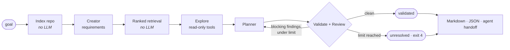

# XPlan

XPlan is a command-line tool that plans code changes before you make them. You give it an engineering
goal and a repository; it finds the relevant code, turns the goal into explicit requirements, drafts a
file-level implementation plan, checks that plan against the repository, has a reviewer critique it,
revises it, and tells you honestly whether the result passed.

It works with **Google Gemini** (cloud) or **any local model served by [Ollama](https://ollama.com)**
(code never leaves your machine).



**What XPlan does not do:** it does not edit files, run commands, apply patches, or execute anything
the model suggests. Planning never writes to the target repository. The only file it writes is the
one you ask for with `--output`.

---

## Requirements

- Node.js **22 or newer** (tested on Node 26)
- One of:
  - a Gemini API key ([Google AI Studio](https://aistudio.google.com/apikey)), or
  - [Ollama](https://ollama.com/download) running locally (or reachable over the network) with a model pulled.
    Models that support tool calling and JSON output work best (for example `qwen3`, `qwen2.5`, `llama3.1`).

## Install

```bash
cd traycer-planner
npm install
npm run build
npm link            # optional: puts `xplan` on your PATH
```

Without `npm link`, run `node dist/main.js …` (or `npm start -- …`) from `traycer-planner/` instead of `xplan …`.

## Configure

Put settings in your environment or in a `.env` file in the directory you run XPlan from
(see [`traycer-planner/.env.example`](traycer-planner/.env.example)).

| Variable | Purpose | Default |
|----------|---------|---------|
| `XPLAN_PROVIDER` | `gemini` or `ollama` | `gemini` if an API key is set, otherwise `ollama` |
| `XPLAN_MODEL` | Model for the chosen provider | provider default |
| `GEMINI_API_KEY` (or `GOOGLE_API_KEY`) | Gemini API key | — |
| `GEMINI_MODEL` | Gemini model | `gemini-3.8-flash` |
| `GEMINI_BASE_URL` | API endpoint (proxies) | `https://generativelanguage.googleapis.com/v1beta` |
| `OLLAMA_HOST` | Ollama server (`host`, `host:port`, or URL) | `127.0.0.1:11434` |
| `OLLAMA_MODEL` | Ollama model | `qwen3` |
| `OLLAMA_NUM_CTX` | Context window in tokens sent as `num_ctx` | `16384` |
| `OLLAMA_KEEP_ALIVE` | How long Ollama keeps the model loaded (e.g. `10m`) | Ollama default |

Precedence: command-line flags › `XPLAN_*` › provider-specific variables › defaults.
Run `xplan doctor` to see the effective configuration, check connectivity, and list available models.

### Local planning with Ollama

```bash
ollama pull qwen3                 # or any model you prefer
xplan doctor --provider ollama    # confirms the server and model are available
xplan plan "Add pagination to GET /users" --repo ~/code/my-api --provider ollama
```

Ollama notes:

- XPlan sends `num_ctx` (default 16384) because Ollama's default context is small. Raise it with `--num-ctx` / `OLLAMA_NUM_CTX` if your hardware allows; lower it if the model runs out of memory.
- Ollama **silently truncates** prompts longer than `num_ctx`. XPlan estimates each prompt before sending it and checks the token count Ollama reports afterwards; if the window was filled, it warns on stderr and records a warning in the plan (Markdown, JSON, and handoff output).
- The code budget scales with the window: by default about 1.6 characters per `num_ctx` token (≈26,000 characters at 16384), 8 files, and a 600 s timeout. Requests are streamed internally so slow local models don't hit Node's 300 s header timeout.
- If the model does not support tool calling, XPlan skips the exploration step with a warning and continues.
- If `OLLAMA_HOST` points to another machine, XPlan says so: your code is then sent to that server.

## Use

```bash
# Plan a change (Markdown to stdout, progress to stderr)
xplan plan "Validate email format when creating a user and return 400 for invalid emails" --repo ./my-app

# Machine-readable output to a file
xplan plan "Add soft delete for users" --repo ./my-app -o plan.json

# Force files into context with @path
xplan plan "Make @src/config.ts read PORT and LOG_LEVEL from the environment" --repo ./my-app

# Goal from a file or stdin
xplan plan --goal-file goal.md --repo ./my-app
cat goal.md | xplan plan - --repo ./my-app

# See exactly which files would be sent to the model, and why — no model call, no credentials
xplan context "rate limit the public API" --repo ./my-app --show-content

# Interactive: plan, refine with feedback, save
xplan --repo ./my-app
```

### Hand the plan to a coding agent

`--format handoff` turns the plan into a step-by-step brief for Claude Code, Cursor, Aider, or a colleague.
It contains the steps in dependency order, the exact files with their verified status, the project's own
verification commands (detected from `package.json` scripts, `go.mod`, `Cargo.toml`, `pyproject.toml`, …), and
explicit rules: don't weaken tests, don't decide open questions silently, verify the model's claims against the
code. If the plan did not pass review, the unresolved findings are at the top of the brief.

```bash
xplan plan "Add soft delete for users" --repo ./my-app --format handoff -o brief.md
# then, for example:  claude "Implement the brief in brief.md"
```

Useful options (see `xplan --help` for all):

| Option | Meaning |
|--------|---------|
| `-r, --repo <dir>` | Repository to plan for (default: current directory) |
| `-p, --provider`, `-m, --model` | Choose provider and model |
| `-f, --format markdown\|json\|handoff`, `-o, --output <file>` | Output format and destination (`handoff` = brief for a coding agent) |
| `--max-revisions <n>` | Review → revise rounds after the first review (default 2, max 5) |
| `--no-review` | Skip the Reviewer; automated checks still run (status `unreviewed`) |
| `--explore-steps <n>` | Tool-calling steps for reading more code (default 3 Gemini / 2 Ollama; 0 disables) |
| `--max-files`, `--max-context-chars` | Context budget |
| `--ignore <glob>` | Extra ignore pattern (repeatable) |
| `--seed`, `--temperature` | Sampling controls for more repeatable runs |
| `--timeout`, `--retries` | Per-request timeout and retry budget |
| `-q`, `-v` | Quiet / verbose (verbose prints why each file was ranked) |

### Exit codes

| Code | Meaning |
|------|---------|
| 0 | Plan produced and `validated` (or `unreviewed` with `--no-review`) |
| 1 | Unexpected internal error |
| 2 | Usage or configuration error (bad flag, missing goal, missing API key, unreadable repo) |
| 3 | Provider or model error (unreachable server, auth, rate limit after retries, invalid model output) |
| 4 | Plan produced, but blocking findings remain after the revision limit (`unresolved`) |
| 130 | Interrupted (Ctrl+C) |

### What a plan contains

- Objective, scope, numbered requirements (`R1…`), acceptance criteria, constraints, out-of-scope items
- Assumptions and open questions (things the model could not verify)
- Ordered tasks (`T1…`) with dependencies, the requirements each covers, rationale, files with action
  (`modify`/`create`/`delete`) **and verified status** (`exists`, `new file`, `⚠ not found in repo`, …),
  affected symbols, specific tests, and completion criteria
- Risks with mitigations
- Review rounds, unresolved and minor findings (each with severity, evidence, and a suggested fix)
- The context that was used: each file with the reasons it was selected
- Verification commands detected from the project, and warnings (e.g. context-window truncation)

The JSON output (`schemaVersion: 1`) has the same content; see `PlanningResult` in
[`src/pipeline.ts`](traycer-planner/src/pipeline.ts).

Real, unedited output from a local 7B model on the bundled fixture app is in [`docs/examples/`](docs/examples/):
the same run rendered as a Markdown plan, a handoff brief, and JSON.

## How it works

| Stage | Model call? | Input → output |
|-------|-------------|----------------|
| Index | no | Walks `--repo` (no symlinks, ignore rules, size/binary limits, secrets withheld) → in-memory index with symbols and import graph |
| Creator | 1 | Goal + repository map (paths and manifests, no file contents) → `Requirements` (requirements, acceptance criteria, assumptions, open questions, search terms, candidate paths) |
| Retrieval | no | Goal + Creator hints → ranked files with reasons → line-numbered excerpts within the character budget, plus "signature cards" (path + defined symbols) for relevant files that didn't fit |
| Explore | ≤ `--explore-steps` | Model may call read-only tools (`list_files`, `read_file`, `search_code`) over the index |
| Planner | 1 | Requirements + context → `Plan` (tasks, files, dependencies, tests, risks) |
| Validate | no | Checks paths exist / are new / are inside the repo / are not secrets; task ids, unknown, circular, or missing (implicit) dependencies; requirement coverage; tests present and test files real |
| Reviewer | 1 per round | Plan + requirements + context + verified file facts + validation results → `Review` (verdict, findings with severity/evidence/fix) |
| Revise | 1 per round | Previous plan + all findings → revised `Plan` |

Every model response is parsed and validated against a Zod schema. Invalid output gets one repair
attempt with the validation errors fed back; if it is still invalid the run fails with exit code 3
instead of producing a half-parsed plan. Both providers are asked for native JSON-schema output
(`responseJsonSchema` for Gemini, `format` for Ollama).

A plan is `validated` only if **both** the automated checks and the reviewer report no blocker or
major findings — a reviewer saying "approve" while listing a major problem does not count. If problems
remain after `--max-revisions`, the plan is still printed, marked `unresolved`, with the findings listed.

The reviewer is itself checked (both safeguards were added after observing these failures with a local 7B model):

- **Evidence grounding:** when a finding quotes the requirements, plan, or code, the quote must actually appear
  there. If it doesn't, the finding is downgraded to minor and labelled, so a fabricated citation cannot block a plan.
- **Convergence:** if a revision leaves the blocking findings unchanged, the loop stops instead of spending more
  calls, and the plan says so.

Retrieval signals, all explained in `xplan context -v`:

- **Lexical:** path terms weighted by rarity (a basename match counts more), defined symbols, and content terms with BM25 saturation and length normalisation; camelCase/snake_case splitting and light stemming (`validate` ≈ `validation`).
- **Structural:** a file that *imports* several matching files is a coordinator (factory, router, registry), usually where a new variant gets wired in, so its boosts add up. A file *imported by* matches (types, logger) gets only its strongest neighbour's boost. Goals that name a `--flag` boost the files that define command-line options.
- **Explicit:** `@path` mentions and the Creator's candidate paths (only if they exist) are pinned first. Test files are down-weighted unless the goal is about tests.

Source layout (`traycer-planner/src`):

```text
main.ts            entry point (loads .env, Ctrl+C handling)
cli.ts             commands, flags, exit codes        interactive.ts  prompt loop
config.ts          flags/env/defaults                 pipeline.ts     orchestration + review loop
agents/            creator, planner (+explore), reviewer, schemas, prompt formatting
llm/               provider interface, gemini, ollama, http (timeouts/retries), structured output, tool loop
repo/              indexer, ignore rules, path/secret safety, symbols/imports, retrieval, read-only tools
repo/project.ts    detect test/build/lint commands from manifests
plan/              deterministic validation; Markdown, JSON, and handoff rendering
errors.ts, logger.ts, redact.ts
```

## Development

```bash
cd traycer-planner
npm run build          # compile to dist/
npm test               # 120 unit and end-to-end tests with mocked models (no network, no keys)
npm run typecheck      # strict type check of src and tests
npm run coverage       # tests + Node's built-in coverage report (≈96% lines, 85% branches)
npm run check          # typecheck + tests
npm run eval:retrieval # retrieval benchmarks; fails if mean recall within budget drops below 90%
node eval/run-eval.mjs --provider ollama --model qwen2.5:7b-instruct   # full pipeline on synthetic tasks
```

- Tests use Node's built-in test runner. Provider tests stub `fetch` (including streamed bodies, stalls, and mid-stream errors). Pipeline and CLI tests use a scripted model. Repository tests build temporary directories, including symlinks that point outside the root.
- There are two benchmarks: a 12-file fixture app (`eval/tasks.json`) and XPlan's own source (`eval/tasks-xplan.json`, 8 maintainer tasks). Results and their limits are in [`docs/EVALUATION.md`](docs/EVALUATION.md).
- CI (`.github/workflows/ci.yml`) runs typecheck, tests with coverage, the retrieval regression gate, and a credential-free CLI smoke test on Node 22 and 24.

## Security and privacy

- **What is sent to the model:** the goal, a repository map (file paths, `package.json` scripts and
  dependency names, other manifest headers), and line-numbered excerpts of the top-ranked files within the
  character budget, plus anything the model reads with the read-only tools. `xplan context --show-content`
  shows exactly what would be sent.
- **Never read:** files matching secret patterns (`.env*` except `.env.example`-style templates, keys and
  certificates, `id_rsa*`, `.npmrc`, `.netrc`, `credentials*`, `secrets*`, service-account JSON,
  `*.tfstate`, `*.tfvars`, `.ssh/`, `.aws/`, …). They appear in the file list as `[sensitive]` only.
- **Redacted:** API keys, tokens, private keys, and `password = "…"`-style assignments found in other files
  are replaced with `[REDACTED]` before indexing; errors and logs are redacted too.
- **Confinement:** symlinks are never followed; tools reject absolute paths and `..`; tools read only from the
  in-memory index, so ignored, binary, oversized, and sensitive files are unreachable.
- **No execution:** XPlan never runs commands or code. Model-suggested tool calls are limited to the three
  read-only tools above.
- **API key handling:** the Gemini key is sent in the `x-goog-api-key` header, never in URLs or logs.
- Redaction is pattern-based and cannot catch every secret. Use `--ignore`, `.gitignore`, or the local
  Ollama provider for sensitive code.

## Known limitations

- Retrieval is lexical plus structural (import graph, CLI-flag definitions); there are no embeddings. It works best
  when the goal uses the codebase's vocabulary; use `@path` mentions otherwise. Benchmarks are small (14 tasks).
- Import resolution covers relative JS/TS imports (including `.js` → `.ts` ESM mapping) and Python modules;
  other languages get symbol extraction only. Symbol extraction is regex-based.
- Only the repository's root `.gitignore` is read, and negated (`!pattern`) rules are ignored.
- Plan quality depends on the model. Small local models (≈7B) are noticeably weaker at long structured
  output and may need `--max-revisions 0`, a smaller `--max-context-chars`, or a larger `--timeout`.
- File facts (exists / new / missing) are verified; everything else in a plan is model output and should be
  read as a proposal.
- Gemini support is covered by mocked HTTP tests; it was not exercised against the live API during this
  revision (no key was available).

## Troubleshooting

| Symptom | Fix |
|---------|-----|
| `Could not connect to Ollama (ECONNREFUSED)` | Start Ollama (`ollama serve`) or set `OLLAMA_HOST`. |
| `Ollama model "x" is not available locally` | `ollama pull x`, or pick an installed model: `xplan doctor`. |
| `Gemini model "x" was not found` | Models are retired regularly. `xplan doctor --provider gemini` lists current ones; set `GEMINI_MODEL`. |
| `Gemini rejected the API key` | Check `GEMINI_API_KEY` / `GOOGLE_API_KEY`. |
| `rate limit or quota exceeded` | Wait, raise `--retries`, or use another model/project. |
| `request timed out` | Raise `--timeout`; reduce `--max-context-chars`; use a smaller model. |
| `model output did not match the expected schema` | Use a more capable model, lower `--temperature`, or reduce context. |
| Exit code 4 / status `unresolved` | Read "Unresolved findings"; refine the goal, answer open questions, or increase `--max-revisions`. |
| A relevant file is missing from the plan | `xplan context "<goal>" -v` shows the ranking; mention the file with `@path`. |

## Changes from the original version

See [`docs/IMPROVEMENT_PLAN.md`](docs/IMPROVEMENT_PLAN.md) for the audit and the full list. In short: the
three copy-paste chat modes became one automated pipeline; `gemini-2.0-flash` (shut down) was replaced by a
configurable model; file access is confined to the repository with secrets withheld; the shell-executing
`executor.ts` and the broken `planner.ts` were removed; both Gemini SDKs were replaced by a small REST client;
Ollama support, structured outputs, validation, retries, and a real test suite were added.
`GOOGLE_API_KEY` still works.

## License

ISC
